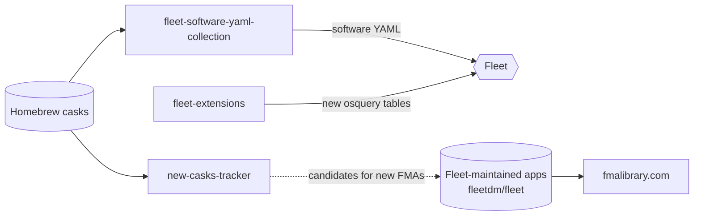

<picture>
  <source media="(prefers-color-scheme: dark)" srcset="./assets/header-dark.svg">
  <source media="(prefers-color-scheme: light)" srcset="./assets/header-light.svg">
   SELECT * FROM allen; — device management, GitOps and osquery tooling at Fleet" src="./assets/header-dark.svg" width="100%">
</picture>

```sql
osquery> SELECT name, works_at, builds, off_the_clock FROM whoami;
+-----------------+-------------------+--------------------------------------------+--------------------------------+
| name            | works_at          | builds                                     | off_the_clock                  |
+-----------------+-------------------+--------------------------------------------+--------------------------------+
| Allen Houchins  | Fleet (@fleetdm)  | fleet extensions, GitOps, MDM stuff,       | hunting, homesteading,         |
|                 |                   | app management tooling                     | comic books                    |
+-----------------+-------------------+--------------------------------------------+--------------------------------+
1 row in set (0.00 sec)
```

### 📡 Live from my trackers

<!-- LIVE:START -->
```sql
osquery> SELECT * FROM fleet_live_stats;
+-----------------------+---------------+---------------------------+
| metric                | value         | trend                     |
+-----------------------+---------------+---------------------------+
| fleet_maintained_apps | 1,434         | ▁▁▃▄▄▄▅▅▅▆▆▆▆▆▇█  (16 wk) |
|   macos / windows     | 973 / 461     |                           |
| apps_added_last_30d   | +10           |                           |
| fma_patches_last_7d   | 595           |                           |
| new_homebrew_casks_7d | 32            | newest: Tinycast          |
| latest_fleet_release  | fleet-v4.94.0 |                           |
+-----------------------+---------------+---------------------------+
6 rows in set. Last refreshed 2026-11-05 20:48 UTC
```
<!-- LIVE:END -->

<sub>Refreshed daily by a GitHub Action that reads my own tracker repos. No third-party stats cards.</sub>

### 🚢 `SELECT * FROM projects WHERE status = 'shipping';`

| project | what it does | stack |
|---|---|---|
| [**fmalibrary.com**](https://fmalibrary.com) · [repo](https://github.com/allenhouchins/fleet-maintained-apps-growth-tracker) | Tracks how Fleet's maintained-app library grows: every app, version and patch, every day | Go · Pages |
| [**fleet-software-yaml-collection**](https://github.com/allenhouchins/fleet-software-yaml-collection) | Fleet-ready software YAML for macOS PKG and Windows MSI/EXE installers, generated from Homebrew, Installomator and WinGet twice a day | Go · Actions |
| [**death-to-extension-attributes**](https://github.com/allenhouchins/death-to-extension-attributes) | Jamf extension attributes vs. a single Fleet query, side by side | osquery |
| [**new-casks-tracker**](https://allenhouchins.github.io/new-casks-tracker/) | Spots brand-new Homebrew casks every 6 hours, with a web page and RSS feed | Go · Pages |
| [**fleet-extensions**](https://github.com/allenhouchins/fleet-extensions) | Go osquery extensions that add tables Fleet doesn't ship: Santa, Defender, Homebrew, snap, system_profiler, sshd_config and more | Go |

<details>
<summary><b>🧰 More tools</b>: Windows app control converters, Fleet Desktop for Windows</summary>

<br>

| project | what it does |
|---|---|
| [applocker-fleet-converter](https://github.com/allenhouchins/applocker-fleet-converter) | Web tool: AppLocker XML → Fleet-ready MDM profile |
| [wdac-fleet-converter](https://github.com/allenhouchins/wdac-fleet-converter) | Web tool: App Control for Business (WDAC) XML → Fleet-ready MDM profile |
| [fleet-desktop-win](https://github.com/allenhouchins/fleet-desktop-win) | Native Windows app that puts Fleet's self-service portal on the desktop, built on fleetd |

</details>

### 🔀 How the pieces fit



### 🗓️ Now

<!-- NOW:START -->
- Cleaning up this profile 🧹
<!-- NOW:END -->

---

<p align="center">
  <a href="https://fleetdm.com">fleetdm.com</a> ·
  <a href="https://allenhouchins.github.io">all my tools</a> ·
  <a href="https://www.linkedin.com/in/allenhouchins">LinkedIn</a>
</p>
